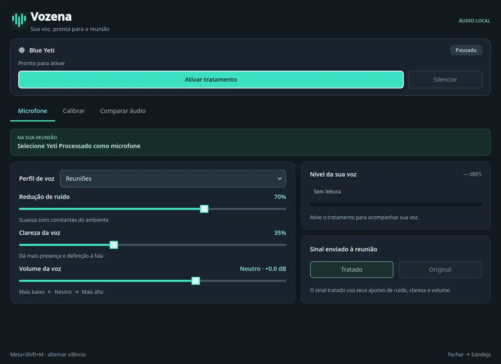

# Vozena

Processamento de voz nativo e local para o Blue Yeti USB clássico em chamadas no Linux.



A Vozena cria um microfone virtual do PipeWire chamado **Yeti Processado**. O sinal passa por filtro passa-altas de 80 Hz, redução de ruído com RNNoise, equalização suave para voz, compressão, ganho por software e limitador de pico. Selecione esse microfone virtual no aplicativo de chamadas e mantenha a Vozena aberta durante a conversa.

Todo o processamento de áudio acontece no seu computador. A Vozena não tem servidor de rede, conta, processamento em nuvem nem telemetria. A comparação opcional grava um par original/tratado de 10 segundos somente quando você manda gravar, mantém o áudio na memória RAM, nunca o reproduz automaticamente e o apaga quando você o descarta ou fecha o aplicativo.

[English](../README.md) · [Site](https://caiolombello.github.io/vozena/) · [Versões](https://github.com/caiolombello/vozena/releases)

## Escopo atual

A Vozena v0.4.2 é uma versão pública de prévia. Ela foi validada em:

- Fedora 44 x86_64
- KDE Plasma com PipeWire 1.6.9
- Blue Yeti USB clássico (`USB b58e:9e84`)

Outras distribuições Linux, interfaces gráficas, arquiteturas, versões do PipeWire e outros microfones ainda não foram validados. O pacote LSP fixado do Fedora exige glibc 2.43; por isso, o preparador aceita apenas Fedora 44 x86_64. Windows e macOS não são compatíveis.

A Vozena não cancela eco e não promete remover todos os sons de fundo. Ela não controla o ganho físico nem o padrão de captação do microfone; faça esses ajustes no próprio Blue Yeti. Não há garantia de funcionamento com um aplicativo de chamadas específico.

## Instalar a versão de código-fonte v0.4.2

A versão publicada é um arquivo limpo de código-fonte. Ela não contém `.deps`, ambiente virtual, binários de plugins nem wheels do Python. Portanto, a preparação precisa de conexão de rede para baixar arquivos fixados do GitHub, Fedora e PyPI.

1. Instale os pré-requisitos do Fedora:

   ```bash
   sudo dnf install python3 python3-pip pipewire pipewire-utils rpm cpio systemd \
     libsndfile libatomic libstdc++ xcb-util-cursor
   ```

   Uma instalação normal do Fedora 44 KDE já fornece as demais bibliotecas gráficas do Qt usadas pelo aplicativo.

2. Pelo navegador, baixe `vozena-0.4.2-source.tar.gz` e `SHA256SUMS` na [versão v0.4.2](https://github.com/caiolombello/vozena/releases/tag/v0.4.2). Coloque os dois arquivos na mesma pasta e confira o arquivo antes de extraí-lo:

   ```bash
   sha256sum --check SHA256SUMS
   tar -xzf vozena-0.4.2-source.tar.gz
   cd vozena-0.4.2
   ```

   Prossiga somente se o `sha256sum` mostrar `vozena-0.4.2-source.tar.gz: OK`.

3. Prepare e instale para o seu usuário:

   ```bash
   python3 scripts/prepare.py
   ```

   O script confere a plataforma compatível, baixa arquivos fixados dos projetos de origem por HTTPS, verifica hashes SHA-256, extrai apenas os plugins e arquivos de licença necessários, instala os pacotes PySide6 fixados por hash em um ambiente persistente e isolado sob `~/.local/share/vozena/runtime/` e instala o aplicativo. Ele nunca abre a Vozena nem captura áudio.

4. Abra a Vozena pelo menu de aplicativos ou execute:

   ```bash
   ~/.local/bin/vozena
   ```

   Para digitar apenas `vozena`, inclua `~/.local/bin` no seu `PATH`. O lançador antigo `~/.local/bin/yeti-voz` continua disponível por compatibilidade.

Para conferir uma preparação existente sem baixar, instalar, abrir o aplicativo ou captar áudio, execute:

```bash
python3 scripts/prepare.py --check
```

## Instalar a partir de um clone Git

Instale os mesmos pré-requisitos do Fedora e execute:

```bash
sudo dnf install git
git clone https://github.com/caiolombello/vozena.git
cd vozena
python3 scripts/prepare.py
~/.local/bin/vozena
```

As opções de preparação para desenvolvimento e CI aparecem em `python3 scripts/prepare.py --help`. `--plugins-only` prepara apenas os plugins nativos fixados, `--root` seleciona outro checkout do código e `--venv-dir` seleciona um diretório absoluto para o ambiente persistente.

## Usar

1. Conecte o Blue Yeti USB clássico e abra a Vozena. O aplicativo inicia pausado.
2. Ajuste redução de ruído, clareza da voz e volume por software, ou escolha um perfil.
3. Se quiser, faça a calibração guiada de 10 segundos: fique em silêncio por 3 segundos, fale normalmente por 7 segundos, confira a sugestão e clique em **Aplicar ajustes**. A calibração nunca aplica uma sugestão sozinha.
4. Clique em **Ativar tratamento**.
5. Selecione **Yeti Processado** como microfone no aplicativo de chamadas.

A Vozena reconecta o grafo PipeWire que ela própria criou depois que o Yeti, o PipeWire ou o computador volta. No KDE, `Meta+Shift+M` alterna o silêncio quando esse atalho está disponível. Fechar a janela mantém o tratamento na bandeja do sistema quando há bandeja; use o menu da bandeja para encerrar.

Os ajustes ficam em `~/.config/yeti-voice/settings.json`. O pacote Python interno e os caminhos de dados locais mantêm os nomes `yeti_voice` e `yeti-voice` para preservar a compatibilidade com instalações existentes.

## Desinstalar

Feche a Vozena, confira os caminhos pertencentes ao aplicativo que seriam removidos e só então desinstale:

```bash
python3 scripts/uninstall.py --dry-run
python3 scripts/uninstall.py
```

O desinstalador confere os marcadores de propriedade da Vozena e se recusa a continuar enquanto houver uma instância aberta. Ele remove as versões gerenciadas do aplicativo, o atalho do menu e os lançadores principal e de compatibilidade. Os ajustes em `~/.config/yeti-voice/settings.json` e o ambiente reutilizável em `~/.local/share/vozena/runtime/` são preservados.

## Contribuição e segurança

Consulte [CONTRIBUTING.md](../CONTRIBUTING.md) para os testes locais e os limites do projeto. Relate problemas de segurança pelo [formulário privado do GitHub](https://github.com/caiolombello/vozena/security/advisories/new), não por uma issue pública.

A Vozena é licenciada sob [GPL-3.0-or-later](../LICENSE). As dependências baixadas mantêm suas próprias licenças; consulte [THIRD_PARTY_NOTICES.md](../THIRD_PARTY_NOTICES.md).

A Vozena é um projeto independente de código aberto, sem afiliação ou endosso da Blue ou da Logitech. Blue Yeti e Logitech são marcas de seus respectivos proprietários.
